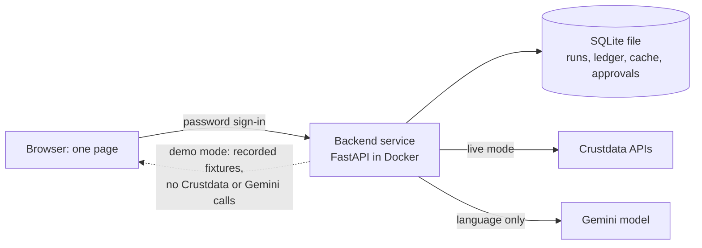

# Vendor Clearance Desk

## 1. What it is

A Vendor Clearance Desk for a mid-size Indian 3PL (third-party logistics company). It replaces the manual check that staff or a KYC firm do before a new carrier or supplier is onboarded and paid.

## 2. Input and output

**In:** one plain-English sentence with the vendor, its website, the claimed director if there is one, and a risk level. For example:

> Check LorryCare, website lorrycare.com, low risk.

**Out:** a memo with the verdict, the reason for each check with its source and dates, what is missing, and the cost. Here is the memo from that recorded live run (from the live validation), as the template writer produces it:

```
Verdict: Can't verify.

Reasons:
- Company exists: Passed. single matching record. Source: crustdata:/company/identify (record date not stated by the source; retrieved 2026-11-22).
- Company is active: Passed. 2 activity signals: headcount, traffic. Source: crustdata:/company/enrich, crustdata:/job/search (record date not stated by the source; retrieved 2026-11-22).
- Claimed director: Can't verify. no claimed director in the request. Source: no source (record date not stated by the source; retrieved 2026-11-22).
- Adverse media: Passed. searched, no relevant adverse report. Source: crustdata:/web/search/live (record date not stated by the source; retrieved 2026-11-22).

What is missing:
- director_match
- claimed_director (not supplied in the request)

Cost: 3.4 credits (rupee cost not set yet).
```

The data source states no record date for these fields, so the memo says so and gives the date we retrieved the data. Rupee cost is not shown yet: the credit-to-rupee rate is still open.

## 3. How it works

1. **Request:** someone types the request in plain English. The language model picks out the vendor name, website and risk level. Code removes the director's name before the model sees the text.
2. **Match:** code matches the vendor to one company record in Crustdata. If several records fit and the website does not settle it, the answer is "can't verify". The system never picks one at random.
3. **Four checks:** the company exists, it is active (staff numbers, job posts, web traffic), the claimed director is listed at the company, and there is no adverse media.
4. **Rules decide:** fixed, written rules turn the check results into one of four verdicts: Cleared, Rejected, Can't verify, Held for approval. The language model never decides anything; it only reads the request and writes the memo in plain English. Code checks every figure and source in the memo against the decision, and uses a template if anything does not match.
5. **A person approves:** Cleared and Rejected are only recommendations until a person clicks Approve or Reject.
6. **Logged and costed:** every data call and model call goes into a ledger with its cost, and every run is saved.

## 4. Features built in

- **Plain English in and out:** a sentence goes in and a readable memo comes out. If something needed is unclear, the page asks instead of guessing.
- **Sourced reasons with dates:** each reason names the record it came from, the record's date (or "not stated by the source") and the date it was retrieved.
- **"Can't verify" instead of a guess:** when the evidence does not settle a check, the memo says so and lists exactly what is missing. A rejection needs dated, sourced, serious evidence; anything weaker stays "can't verify".
- **Credit and time caps per run:** a run stops cleanly at its cap, which is currently proposed as 50 credits and 300 seconds. The memo names the checks that did not run. The web page also caps credits per signed-in session.
- **A ledger of every call:** every Crustdata call and every model call is recorded with the cost the API reports. In the live validation the ledger matched the account balance exactly.
- **Safe restart:** if the process is killed mid-run and restarted, the run picks up where it stopped. Paid calls that already finished are not repeated, and each approval action happens exactly once.
- **Human approval:** nothing irreversible happens without a person. Approving only records the decision; nothing is sent outside the app.
- **Duplicate requests merged:** "Delhivery", "Delhivery Ltd" and "M/s Delhivery Limited" become one run and one approval.
- **A source that does not answer is not a clean result:** if a source stays unreachable after retries, the case is held for a person.
- **Sensitivity controls:** three settings on the page. *Strictness* sets how much evidence a check needs before it passes. *Evidence to reject* is standard or high; high needs two sources. *Data freshness* sets how recent staff-number data must be (30, 90 or 180 days, or the default of 60). Until strictness presets are approved, the three strictness choices give the same result, and the page says so. The hard rules cannot be changed from the page.
- **Director privacy:** the claimed director's name is used only while the check runs. It is never stored, logged or sent to the model. Only a salted hash and the match result are kept.

## 5. Tech stack

| Part | Why |
|---|---|
| Python | One language for the checks, rules, tests and web server; quick to read and change. |
| SQLite | One file holds run state, the ledger, the cache and approvals. No database server to run, and it is easy to inspect. |
| FastAPI (with uvicorn) | A small web server for the single-page approval screen, with input checking built in. |
| Plain HTML and JavaScript | One page with no framework and no build step. |
| Crustdata APIs | Company records, staff numbers, job posts, people profiles and web search, all from one provider. |
| Gemini (`gemini-3.8-flash`) | Language only: reads the request and drafts the memo. If it is off or slow, templates are used. |
| Docker | One container image to host the service; keys come from environment variables, never from the image. |

## 6. Infrastructure



Demo mode is served by the same backend service (`APP_MODE=demo`, the default). It replays recorded results and spends nothing. It is not hosted anywhere public yet.

## 7. Key design choices

Most of these are still marked PROPOSED in DECISIONS.md until the owner signs them off.

- **Rules decide, not a score:** each verdict can be traced to a written rule, so a person can see why it came out that way.
- **No machine-learning model for the verdict:** there are too few labelled cases to train one honestly, and its decisions would be harder to explain to a person.
- **Fixed checks:** the same input and the same data always give the same verdict.
- **"Can't verify" over a guess:** a wrong answer costs more than an honest "can't verify", so the system says what is missing.
- **A person approves:** clearing and rejecting a vendor cannot be taken back, so neither happens without a person.
- **SQLite:** one file, no server, and it survives a crash. That is enough for one desk.
- **Privacy by keeping less:** only the data a check needs is taken in, and the director's name is never kept.
- **Caps and a ledger:** every run has a ceiling, and every call is counted, so cost is known and bounded.

## 8. What it does not do

- No sanctions or watch-list screening.
- No court, FIR or regulator records.
- No GST status and no company-registry IDs (CIN, GSTIN, DIN): Crustdata does not provide them.
- No check of who really owns the company (beneficial ownership).
- No continuous monitoring: each check is one point in time.
- Small and new firms more often end at "can't verify", because they have little data in the source. The memo then names the registry evidence to ask for.
- "Director" means listed at the company in profile data, not a director of record.

## 9. Run it

Install once: `pip install -r requirements.txt`.

**Demo mode** (no keys and no cost; replays recorded results, labelled on screen):

```
APP_PASSWORD=choose-one uvicorn app.server:create_app --factory --port 8000
```

Then open http://127.0.0.1:8000.

**Live mode** (real Crustdata checks; Gemini is optional, and without it templates are used):

```
APP_MODE=live CRUSTDATA_API_KEY=... GEMINI_API_KEY=... APP_PASSWORD=choose-one uvicorn app.server:create_app --factory --port 8000
```

From the command line: `python pipeline.py run --vendor "NAME" --website DOMAIN --tier low`.

**Tests:** `python -m pytest -q`.

**More detail:** ARCHITECTURE_TECHNICAL and ARCHITECTURE_BUSINESS (in `docs/`), UNIT_ECONOMICS (in `finance/`), DECISIONS, and NOTES (approaches tried).
