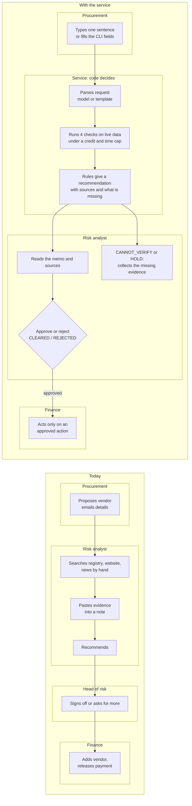

# Business architecture

Figures in this document come from the ledger, a committed report (`probe/REPORT.md`, `evaluation/live_validation.md`, `finance/cost_report_output.txt`) or `finance/assumptions.json`. Anything the owner still has to supply is marked **ASSUMPTION - TODO**.

## 1. The customer

A mid-size Indian third-party logistics company (3PL). It takes on new carriers, fleet owners, warehouse operators and suppliers all the time, and must check each one before money moves: an advance to a new fleet owner, or a supplier added to the payment system. The people who use the service:

| Role | What they need |
|---|---|
| Procurement executive | Raises the request when a new vendor is proposed; wants an answer the same day. |
| Risk / compliance analyst | Does the checks today; signs off; must be able to defend the decision later. |
| Head of procurement or risk | Owns the policy (how strict, what counts as enough evidence); approves exceptions. |
| Finance (accounts payable) | Will not release a payment to a vendor that is not cleared. |

Monthly vendor volume, analyst cost per check and today's turnaround are **ASSUMPTION - TODO** (`finance/assumptions.json`: `vendors_per_month_customer`, `analyst_cost_inr_per_check`, `manual_turnaround_hours`).

## 2. The manual process this replaces

Vendor onboarding checks done by an analyst, or bought from a KYC firm:
1. Does the company exist under this name? (search the registry, the website, the GST portal)
2. Is it still trading? (recent activity, staff, filings)
3. Is the person who signed the form really a director or officer?
4. Is there bad press: fraud, default, FIR, blacklisting?
5. Write a short note and send it for sign-off.

Today these steps are done by hand, in browser tabs, with the evidence pasted into an email or a sheet. The note rarely records which page said what or on what date.

## 3. Who does what: today versus with the service

| Step | Today | With the service |
|---|---|---|
| Request | Email with the vendor's details | One sentence in the web UI, or `pipeline.py run --vendor ... --website ...` |
| Exists, active, director, adverse media | Analyst, by hand | Code, on Crustdata data, each result with its source and the record's date where the source gives one |
| Write-up | Analyst | Memo from a fixed fact sheet (template, or the model with every figure checked) |
| Decision | Analyst recommends, head signs off | Service recommends; **a person approves or rejects every CLEARED and REJECTED** |
| Unclear cases | Analyst decides how far to dig | The service says CANNOT_VERIFY and names exactly what is missing; the analyst collects it |
| Outages | Analyst retries later | A source that times out is retried; if it stays down, the case is held for a person, never read as "nothing found" |

## 4. Where the human approves

- **Every CLEARED and every REJECTED** becomes a pending action (`core.finalize`). Nothing happens until a person presses Approve or Reject (web UI `/api/actions/{key}/approve|reject`). An approved action is only recorded locally (`app_effects` table); the service never adds the vendor to another system, never pays, never messages the vendor.
- **CANNOT_VERIFY and HOLD_FOR_APPROVAL** have no action at all: they go to a person as they are, with the list of what is missing.
- The decision to clear a vendor is treated like a rejection (cannot be taken back once money moves): D2 proposes that both need approval, and the code already does this.

## 5. Service levels

| Item | Level | Source |
|---|---|---|
| Credit ceiling per vendor | 50 credits, stopped cleanly (CANNOT_VERIFY naming the checks not run) | `config.json max_cost_credits_per_run` (PROPOSED, D13) |
| Time ceiling per vendor | 300 s | `config.json max_seconds_per_run` (PROPOSED, D13) |
| Measured cost per vendor | see `finance/UNIT_ECONOMICS.md` (from the ledger) | `finance/cost_report.py` |
| Turnaround promised to the customer | **ASSUMPTION - TODO** (`service_turnaround_hours`) | |
| Availability | Depends on Crustdata. A timeout holds the case; it never becomes a pass. | `core.call_with_retry`, `decision.decide` |

What it **will** verify (from Crustdata, `probe/REPORT.md`):
- A company record matching the name (our own similarity, separated by the website when several match).
- Activity: headcount now and its trend and age, job postings in the last 90 days, web traffic.
- Whether a person with the claimed name is listed at that company in profile data (not a director of record).
- Adverse-media discovery: two web searches; a pass is labelled "limited coverage" with the counts.

What it **will not** verify (see section 9): registry status, CIN, GSTIN, DIN, directors of record, sanctions, court cases, GST filing status, beneficial ownership.

Expected outcome mix: in live validation every real vendor so far ended in CANNOT_VERIFY under the proposed parameters (`NOTES.md`, `evaluation/live_validation.md`). The value today is a sourced first pass and an exact list of what is missing, not automatic clearance.

## 6. How the customer uses the sensitivity controls

The web UI has three dials (`controls.py`, presets in `config.json control_presets`, D38):

| Dial | Choices | What it changes | When the customer would use it |
|---|---|---|---|
| Strictness | lenient, balanced, strict | Tunable policy thresholds (name similarity, activity signals, search counts, severities). **All three are the same today**: the presets are empty until the owner approves a tuned candidate file. | Lenient for low-value, repeat suppliers; strict for carriers that will get an advance. |
| Rejection evidence | standard, high | `reject_min_sources` 1 or 2 | High when a wrong rejection would hurt a relationship. |
| Freshness | policy (60 days), 30, 90, 180 | `max_series_age_days` | Shorter when the customer wants recent activity data only. |

What the dials can never change (`controls.HARD_KEYS`, floors in `controls.FLOORS`): a rejection always needs a source and a date (`reject_require_dated`), at least one search must run before "nothing found" counts, a deleted profile or a wrong domain is never an automatic fail, and the verdict rules in `decision.py`. A run under non-default settings is its own run, not a duplicate of a default run. The risk tier (low, medium, high) on each request also raises the activity signals required (`tier_extra_*`).

## 7. Rollout

| Phase | What happens | Exit test |
|---|---|---|
| 1. Pilot | Run the service on a set of past vendors whose outcome is known; no live decisions. Costs from the ledger. | No wrong definitive verdict on the labelled set (`evaluation/run_eval.py`); cost per vendor within the budget (**ASSUMPTION - TODO**: `pilot_vendor_count`). |
| 2. Shadow mode | Every new vendor goes through both the analysts and the service. Analysts do not see the service's verdict before they decide. Compare. | Agreement rate and the cases where they differ are reviewed by the head of risk; thresholds are tuned in report-only mode (`run_eval.py --compare`, `evaluation/tuning.py`). Duration **ASSUMPTION - TODO** (`shadow_weeks`). |
| 3. Assisted | The service runs first; the analyst reviews its memo and sources and approves or rejects. CANNOT_VERIFY cases go to the analyst with the missing list. | Analyst time per vendor falls (**ASSUMPTION - TODO**: target), with no rise in wrong clearances. |

The service never moves to "automatic": approval by a person is a hard rule in the code, not a phase.

## 8. Risks and failure modes

| Risk | What the code does | What remains |
|---|---|---|
| Wrong company matched (lookalike name, shared domain) | Own similarity with a floor; ties broken only by the supplied website, else "ambiguous match" (CANNOT_VERIFY) | A lookalike with the same website and a near-identical name would pass exists. |
| Namesake in adverse media | A hit must name the full company phrase or the domain; a rejection needs a dated, resolved, severe, sourced report | Most real hits are undated redirects, so adverse findings rarely reach "fail"; they show as "Suspicious" for a person. |
| Small or new firms look inactive | Missing activity data is `unknown`, never `fail` | Small genuine vendors end in CANNOT_VERIFY more often (`scripts/fairness_report.py`). |
| Source outage or rate limit | Retry, then HOLD; never "nothing found" | Held cases need a person to retry. |
| Run costs more than planned | Per-run credit and time caps, UI session cap | One call can take a run past its cap by that call's cost. |
| Crash mid-run | Resume from saved steps; cached responses are not paid twice; one action per decision | See `docs/ARCHITECTURE_TECHNICAL.md` section 3 for the narrow gaps. |
| Model misreads a request or invents a fact | Fields must appear in the sentence; memo figures checked; template fallback | A model could choose the wrong span of the sentence as the vendor name; the parsed request is echoed back to the user. |
| Prompt injection in a request or a fetched page | Text is data; the model never decides; no code path from model output to a verdict | |
| Stale "current" roles in profile data | Director check says "listed at this company per profile data (not a director of record)" | It is not proof of directorship. |

## 9. What the service explicitly does not do

- **Sanctions screening**: no sanctions or watch lists are checked.
- **Court records**: no court, FIR or tribunal database is searched; only web search snippets.
- **GST status**: GSTIN format is recognised in a request, but no GST portal lookup is made.
- **Registry status and directors of record**: no MCA or KYC source (D9 open). CIN, DIN and incorporation are never confirmed.
- **Beneficial ownership**: not checked.
- **Monitoring**: one check per request; no re-checks on a schedule.
- **Contacting anyone**: the service never emails, messages or pays a vendor or a third party. Outgoing messages, if ever added, are drafts held for approval.
- **Final decisions**: every clearance and rejection is a person's decision.
