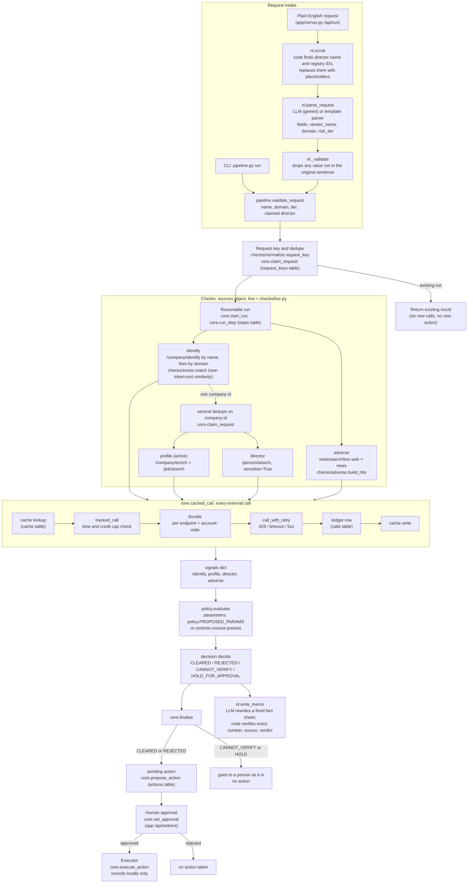
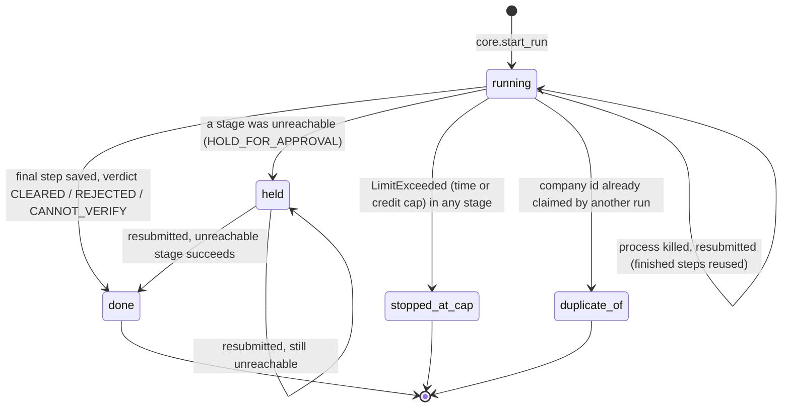
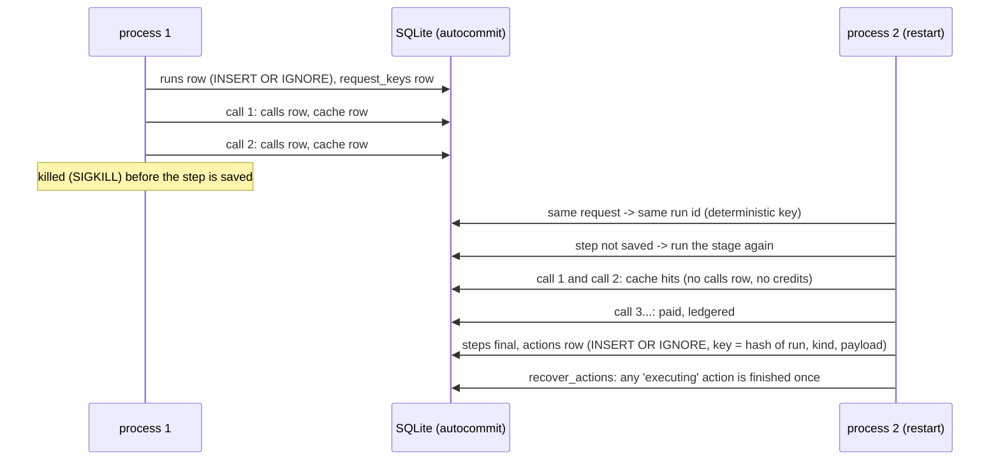
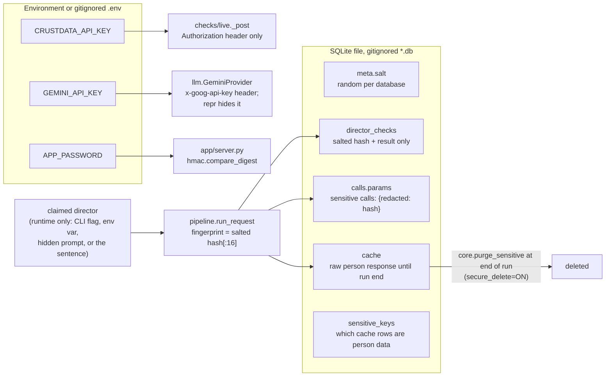

# Technical architecture

This describes the code as it is in the repo. Where something is planned but not built, it says so. File references are relative to the repo root. Parameter values marked PROPOSED are placeholders that the owner has not decided yet (`DECISIONS.md`).

## 1. Components and data flow



What each box is in the code:

| Box | Code | Notes |
|---|---|---|
| Plain-English request | `app/server.py` `/api/run` -> `nl.parse_request` | The web UI is password protected (`APP_PASSWORD`). Demo mode replays fixtures (`app/demo.py`, endpoint `/demo/replay`, 0 credits). |
| nl parser | `nl.scrub`, `nl.template_fields`, `nl.parse_request`, `nl._validate` | Code removes the claimed director and registry IDs before the model sees the text. The model is asked for three fields only; any value that is not literally in the sentence is dropped. Without a key or on any model error the template parser is used. |
| Request key and dedupe | `checks/normalize.request_key`, `core.claim_request`, `pipeline.params_tag` | Key before resolution: normalised name + normalised domain (+ salted fingerprint of the claimed director, + a tag when non-default control settings are used). After resolution: Crustdata company id + the same extras. The first run to claim a key owns it. |
| Resumable run | `core.start_run`, `core.run_step`, `pipeline.run_request` | Each stage (`identify`, `profile`, `director`, `adverse`, `final`) is a step. A finished step returns its saved result on restart. |
| exists | `checks/live.LiveSources.identify`, `checks/exists.match`, `pipeline.identify_signals`, `policy._exists` | Crustdata's confidence score is not used for the choice. Several candidates above `candidate_name_sim_floor` are separated by the supplied domain, otherwise "ambiguous match". |
| active | `LiveSources.profile`, `policy._active` | Headcount, its trend and age, job postings in 90 days, web traffic. |
| director | `LiveSources.director`, `policy._director` | Person Search by name and employer. Returns booleans only. Profile data, not a director of record. |
| adverse | `LiveSources.adverse`, `checks/adverse.build_hits`, `policy._adverse` | Two searches (web, news). A pass is labelled "limited coverage" with the search and result counts. |
| registry format | `nl.REGISTRY_PATTERNS` | Only a format match (CIN, GSTIN, LLPIN) inside `nl.scrub`, so the IDs are kept away from the model. No check uses the IDs (`nl.to_pipeline_request` passes them through, `pipeline.validate_request` ignores them). There is no registry source (D9). |
| cached_call | `core.cached_call`, `core.tracked_call`, `core.throttle`, `core.call_with_retry` | See section 1.1. |
| signals | dict built in `pipeline.run_request` | The shape is documented at the top of `policy.py`. |
| policy | `policy.evaluate` | Signals to per-check results: `pass`, `fail`, `unknown` (plus `unreachable` and `not_run` set by the pipeline). Conflicting sources become `unknown` (`policy._conflicts`). A fail with too few sources becomes `unknown` (`policy._guard_fails`). |
| decision | `decision.decide` | Unreachable wins (HOLD), then a cap stop (CANNOT_VERIFY), then fail (REJECTED), then unknown or low confidence (CANNOT_VERIFY), else CLEARED. |
| finalize, pending action | `core.finalize`, `core.propose_action` | CLEARED -> `onboard_vendor`, REJECTED -> `reject_vendor`, both `pending`. The action key is a hash of (run, kind, payload), so a retry cannot create a second one. |
| human approval | `core.set_approval` | Only from `pending`. Called by `app/server.py` `/api/actions/{key}/{approve,reject}`. |
| executor | `core.execute_action`, `core.recover_actions` | Executors in the repo only write a row locally: `app/server.py executor` (`app_effects`), `devconsole/app.py` (`effects`). Nothing is sent. |

### 1.1 Inside `core.cached_call`

```mermaid
sequenceDiagram
  participant S as check source
  participant C as cached_call
  participant T as tracked_call
  participant R as call_with_retry
  participant H as throttle
  participant A as API
  S->>C: endpoint, params, fn
  C->>C: key = sha256(endpoint, params)<br/>(salted when sensitive)
  alt cached and TTL not expired (TTL is OFF: never expires)
    C-->>S: cached response, no ledger row, no credits
  else
    C->>T: go()
    T->>T: elapsed > max_seconds_per_run? raise LimitExceeded<br/>spent > max_cost_credits_per_run? raise LimitExceeded
    T->>R: attempts (config retry.attempts = 3)
    loop each attempt
      R->>H: wait for a slot (60 s window, per endpoint and account)
      R->>A: fn()
      alt 429
        A-->>R: RateLimited(retry_after)
        R->>R: sleep retry_after, or backoff x attempt
      else timeout or 5xx
        A-->>R: TransientError
        R->>R: sleep backoff x 2^attempt
      end
    end
    R-->>T: response, or SourceUnreachable after the last attempt
    T->>T: INSERT calls row (endpoint, params or redacted hash, status, credits from the response, ms, ts)
    T-->>C: response
    C->>C: INSERT cache row; if sensitive, INSERT sensitive_keys row
    C-->>S: response
  end
```

- The throttle is a sliding 60-second window per exact endpoint (`rate_limits_per_min`) and account-wide (`account_rpm`). After a restart it is rebuilt from the `calls` table so a resumed run does not burst. It is thread-safe.
- The cost check happens before each call and compares what the run has already spent with the cap. One call can therefore take a run past the cap by at most that call's own cost (see `finance/BUDGET_CONTROLS.md`).
- Credits come from the API response (`x-credits-used` header in `checks/live._post`). Model calls are logged with 0 credits and their token counts (`llm.extract`).

## 2. State machines

### 2.1 Run (`runs.status`)



Notes from the code (`pipeline.run_request`):
- `invalid` is returned to the caller but never stored: no run row is created for a request that fails validation.
- A held run does not save its `final` step, so a later resubmission re-runs only the unreachable stage (finished stages come from `steps`).
- A run stopped at a cap saves its `final` step. Resubmitting the same request returns the same `CANNOT_VERIFY` result; it does not spend more.
- Check states inside a run: `pass`, `fail`, `unknown`, `unreachable` (retries exhausted), `not_run` (cap reached first).

### 2.2 Action (`actions.status`)

```mermaid
stateDiagram-v2
  [*] --> pending: core.finalize (CLEARED or REJECTED only)
  pending --> approved: set_approval(approve=True)
  pending --> rejected: set_approval(approve=False)
  approved --> executing: execute_action claims it (UPDATE ... WHERE status='approved')
  executing --> done: executor returned
  executing --> executing: process killed; recover_actions at start-up runs the executor again
  rejected --> [*]
  done --> [*]
```

Each transition is a single conditional `UPDATE`, so two workers cannot both claim the same action.

## 3. Crash recovery and exactly-once



What makes it exactly-once:
- **Same run:** the run id is derived from the request key, so a resubmission after a crash lands in the same run.
- **No repeated paid call:** every response is cached under a hash of (endpoint, params) right after it is ledgered. The cache never expires (`cache_ttl_seconds.default` is null, D24).
- **One action:** `propose_action` uses `INSERT OR IGNORE` with a deterministic key.
- **One execution:** `execute_action` claims with a conditional update; `recover_actions` finishes anything left in `executing`. Executors must be idempotent per key (all executors in the repo use `INSERT OR IGNORE` on the key).
- **Every write is durable:** the connection is in autocommit mode.

Known gaps (from reading the code, not fixed here because `core.py` is owned by another session):
- The ledger row and the cache row are two separate writes. A kill in the moment between them leaves a paid call with no cache entry, and the resumed run pays for it again. The ledger shows both calls, so the cost report and the balance still agree. Fix: write both in one transaction.
- A kill during an HTTP request loses the response. If the API charged for it, the ledger has no row and the account balance will be lower than the ledger says (the reconciliation in `finance/cost_report.py` shows the difference).
- The executor runs and then the status is set to `done`. A kill between the two makes `recover_actions` run the executor again, which is why executors must be idempotent.

## 4. Secrets and personal data



| Item | Where it lives | When it goes |
|---|---|---|
| `CRUSTDATA_API_KEY` | Environment, or `.env` (gitignored) read by `llm.load_dotenv` | Never written to the DB, logs or files. Sent only in the request header. |
| `GEMINI_API_KEY` | Same | Same; `GeminiProvider.__repr__` never shows it; exception text from the HTTP library is reduced to its type name. |
| `APP_PASSWORD` | Environment | Compared in constant time; sessions are random cookies held in memory. |
| Per-database salt | `meta` table in the DB | Lives as long as the DB. Without it the salted hashes cannot be linked to a name. |
| Claimed director name | Memory only, for the length of the run. In the UI it is cut out of the sentence by code before the model sees it. | Never stored. The DB keeps a salted hash (`director_checks`, and the first 16 hex characters inside the request key). |
| Person Search request params | `calls.params` as `{"redacted": <hash>}` | Never stored in clear. |
| Raw Person Search response | `cache` row, listed in `sensitive_keys`; never written to `probe/raw/` (`save_raw=False`) | Deleted by `core.purge_sensitive` when the run finishes. If the process dies first, it stays until the run is resumed and finishes, or until `scripts/purge.py` runs. |
| Company responses | `cache` (no expiry, D24 open) and `probe/raw/live/*.json` (gitignored) | Kept. Company data, but may contain names of leaders (enrich `people` fields are not requested by the live check). |
| Vendor name, domain, tier | `runs.request` | Kept (company data). |
| Probe files | `probe/` | Pseudonymised; history redacted (D29). |

## 5. Deterministic versus LLM

| Step | Who | Why |
|---|---|---|
| Finding the director name and registry IDs in a sentence | Code (regex, `nl.scrub`) | So that personal data and IDs never reach the model. |
| Reading vendor name, domain, tier from a sentence | LLM if configured, else template; then code validation | The model is good at messy English, but every value it returns must literally appear in the sentence, or it is dropped. The schema is fixed (three fields). |
| Matching the company, every check, every threshold | Code (`checks/exists.py`, `policy.py`) | A verdict must be reproducible and explainable from sourced fields; thresholds are owner decisions. |
| Verdict | Code (`decision.py`) | The rules: deterministic rules decide; a wrong answer costs more than `CANNOT_VERIFY`. |
| Clearing or rejecting | A person (`core.set_approval`) | Event rule: anything that cannot be taken back needs a person. |
| Memo wording | LLM if configured, else template | Code checks the memo against the fact sheet (`nl.verify_memo`): exact verdict text, no other verdict word, every number and source must come from the facts, every missing item copied. A failed check uses the template memo. |

Why the LLM never decides: it never sees the signals or the parameters, its output goes only into request fields (checked against the sentence) or a memo (checked against the decision), and there is no code path from model output to `policy.evaluate`, `decision.decide` or `core.set_approval`. Fetched pages and request text are passed as data; the prompts say so (`nl.PARSE_SYSTEM`, `nl.MEMO_SYSTEM`).

## 6. Parameters

"Control" is the customer-facing dial in `controls.py` (shown in the web UI) that changes the parameter. "None" means no dial changes it.

### 6.1 Policy parameters (`policy.PROPOSED_PARAMS`)

| Parameter | Value | Check | Control | Decision |
|---|---|---|---|---|
| `name_sim_min` | 0.90 | exists | `strictness` (tunable; all presets empty so far) | D5 |
| `candidate_name_sim_floor` | 0.85 | exists | `strictness` (tunable) | D35 |
| `domain_mismatch_is_fail` | False | exists | None (hard rule, `controls.HARD_KEYS`) | D4 |
| `deleted_is_fail` | False | exists | None (hard rule) | D3 |
| `min_headcount` | 5 | active | `strictness` (tunable) | D7 |
| `max_decline_pct` | 30.0 | active, conflicts | `strictness` (tunable) | D7 |
| `max_series_age_days` | 60 | active | `freshness_days` 30 / 90 / 180 / policy | D7, D38 |
| `min_jobs_90d` | 1 | active | `strictness` (tunable) | D7 |
| `active_min_signals` | 2 | active | `strictness` (tunable) | D6 |
| `tier_extra_medium` | 0 | active | `strictness` (tunable); also the request's `risk_tier` | D6, D12 |
| `tier_extra_high` | 1 | active | `strictness` (tunable); also the request's `risk_tier` | D6, D12 |
| `min_searches` | 2 | adverse | `strictness` (tunable, floor 1) | D8 |
| `adverse_min_severity` | 2 | adverse | `strictness` (tunable, floor 1) | D8 |
| `reject_min_sources` | 1 | any fail | `rejection_evidence` high = 2 (floor 1) | D32 |
| `reject_require_dated` | True | adverse | None (hard rule) | D32 |
| `reject_min_severity` | 3 | adverse | `strictness` (tunable, floor 1) | D32 |
| `conflict_adverse_terms` | closed, insolvent, struck_off, fraud | conflicts | None (hard rule) | D33 |

`strictness` lenient / balanced / strict are all empty in `config.json control_presets` until the owner approves `evaluation/presets_candidate.json` (D38), so today they give the same result.

### 6.2 Engine and service parameters (`config.json`)

| Parameter | Value | Used by | Control | Decision |
|---|---|---|---|---|
| `max_cost_credits_per_run` | 50 | `core.tracked_call` | None | D13 |
| `max_seconds_per_run` | 300 | `core.tracked_call` | None | D13 |
| `session_credit_cap` | 100 | `app/server.py` (UI session) | None | D39 |
| `rate_limits_per_min` | company, person, job 5; web 10; default 5; autocomplete 300; `/social_post/search` 100; `/llm/generate` 30; `/demo/replay` 600 | `core.throttle` | None | account limits; `/llm/generate` D36 |
| `account_rpm` | 100 | `core.throttle` | None | account limit |
| `retry.attempts`, `retry.backoff_seconds` | 3, 2 | `core.call_with_retry` | None | D30 |
| `cache_ttl_seconds.default` | null (no expiry) | `core.cached_call` | None | D24 |
| `min_match_confidence` | 0.9 | `decision._decide` (a check below it is CANNOT_VERIFY) | None | not in DECISIONS.md |
| `llm.provider`, `llm.model`, `llm.timeout_seconds`, `llm.attempts` | gemini, gemini-3.8-flash, 20, 2 | `llm.py` | None | D36 |
| `inr_per_credit` | null | `nl._rupees` (memo) | None | D16 |
| `price_inr_per_check` | 0 | not read by any code | None | D16 |
| `control_presets` | see 6.1 | `controls.py` | the three dials | D38 |

## 7. What is not built

Monitoring and re-check schedules, the network graph, a Next.js front end, browser automation (Playwright), any ML model, a registry source (D9), a news source other than Crustdata web search (D10), sanctions lists, court records, GST status and beneficial ownership. Quote-grounded facts (`core.add_fact`) exist in the engine and the dev console, but the live checks do not call `add_fact`; check results carry endpoint names (`crustdata:/company/enrich`) as sources, and Crustdata gives no company-level record date.
